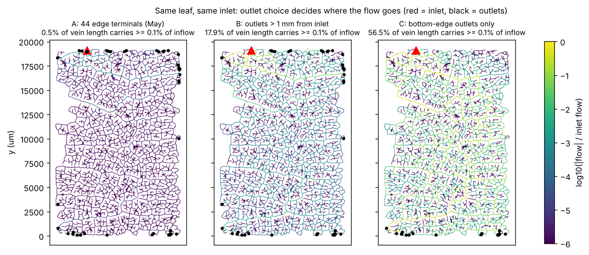

# Oxygen delivery in decellularised leaf scaffolds: a simulation pipeline and its failure analysis

Decellularised leaves are being studied as ready-made, perfusable scaffolds for
tissue engineering. This project asks a computational question: given the vein
network of a real leaf, could perfusion through it keep surrounding tissue
oxygenated?

The pipeline segments a cleared-leaf image, converts the veins into a flow
network, solves pressure and flow (NetFlowV2), and computes tissue oxygen
(GreensV4, and a custom screening solver). It started as my biomedical
engineering capstone (May 2026). Most of the May results were lost, so in
October 2026 I rebuilt them from the files that survived, rebuilt both
reference solvers from source, and checked every claim against a file. That
re-analysis changed the main conclusions, and it is what this repository
documents.



## Main findings

Every number below comes from a file in `results/` and can be regenerated
with the commands further down.

**1. Where the outlets are decides whether the leaf is perfused at all.**
NetFlowV2, rerun from source on the saved network, reproduces the May flow
solution exactly (all 13,615 segments). In the May setup, 44 outlets around
the leaf edge sat 0.0045 mmHg below the inlet, and **99.5% of the inflow left
through two outlets 125 and 177 µm from the inlet**. Only 0.5% of vein length
carried at least 0.1% of the inflow. With outlets only on the far edge, that
rises to 56.5% (figure above; `results/leaf_ACJ01/netflow/outlet_study.csv`).

**2. GreensV4 did not fail because of leaf loops.** The May manuscript
concluded that the leaf's loops make the flow impossible to order upstream to
downstream. The saved files show otherwise:

- Neither flow graph contains a directed cycle. Flow follows pressure, so
  there can't be one.
- GreensV4's ranking routine (`putrank.cpp`) cannot rank any node fed by a
  segment with flow exactly 0. The May input had 3,614 of these, so only
  **8.3% of nodes** could be ranked.
- Blind-ending veins carry tiny round-off flows that make their tips look like
  inlets to `convect.cpp`: **725 fake inlets** and 908 nodes failing its 1%
  flow-balance check.
- Removing zero-flow segments and blind-ending branches keeps **468 of 476
  loops** and clears every one of these errors
  (`results/leaf_ACJ01/greensv4/diagnosis.csv`).
- GreensV4 also returns NaN for **any** cell-free perfusate. Its own sample
  problem fails as soon as blood is replaced by PBS, because its first guess
  divides by a haematocrit-weighted length that is zero. A one-line patch
  fixes this (`solvers/patches/`), and the blood sample gives an identical
  answer with and without it.
- With both fixes, GreensV4 runs on the cleaned leaf with no errors and no
  NaN, and oxygen consumed comes to balance oxygen supplied. It does **not**
  converge, though: the vessel PO2 change per iteration falls more than 1,000-fold, then
  levels off 3,000 to 8,000 times above GreensV4's tolerance and stays there for
  100 iterations ([convergence plot](results/leaf_ACJ01/figures/greensv4_convergence.png),
  `results/leaf_ACJ01/greensv4/run_summary.csv`). No GreensV4 oxygen map is
  reported. GreensV4's own diagnostics place the largest remaining error at
  low-flow segments: with a cell-free perfusate, 69% of segments fall under its
  low-flow rule, which was designed for blood. That is the next thing to test.

**3. Two bugs in my own May code, found and fixed.**

- `run_pipeline.py` never wrote the inlet oxygen into the GreensV4 input, so
  the May GreensV4 run had **0 mmHg at the inlet**. It is fixed, with a test.
- The oxygen screening solver overshot at high wall permeability. On the real
  leaf at `P_wall` = 1e-4 m/s, it predicted tissue pO2 up to **824 mmHg from a
  150 mmHg inlet**. A semi-implicit exchange update fixes it. At `P_wall` =
  1e-6, the level used in the May report, results change by at most
  0.06 mmHg.

**4. On the real leaf, wall permeability decides tissue oxygen.** In a 24-run
sweep, tissue pO2 relative to inlet varies by 0.96 across the tested wall
permeabilities, 0.14 across consumption rates and 0.02 across inlet levels. No
run puts tissue above the inlet. The rebuilt leaf reproduces the May report's
conclusion (0% vs at least 89% of tissue at or above 15 mmHg for
`P_wall` 1e-8 vs 1e-6), with somewhat lower oxygen values
([`analysis/oxygen_sweep_analysis.md`](analysis/oxygen_sweep_analysis.md)).

## What the repository contains

| Stage | Tool | Code | Can be rerun here |
|---|---|---|---|
| 1. Vein segmentation of a cleared-leaf image | LeafVeinCNN v2.14 (external) | settings only | no: the output was lost |
| 2. `.mat` → NetFlowV2 network: resampling, diameters, boundary checks | own | `src/preprocessing/` | yes, on the synthetic leaf |
| 3. Pressure and flow | NetFlowV2 (Secomb lab) | `solvers/build_solvers.sh` | yes, real leaf |
| 4. Green's-function tissue oxygen | GreensV4 (Secomb lab) + one-line patch | `src/analysis/greens_runs.py` | yes, real leaf |
| 5. Oxygen screening on the vein mask | own (`oxy_sim_mat.py`) | `src/solver/` | yes, real leaf (rebuilt mask) |
| 6. Parameter sweep and analysis | own, R Markdown | `src/solver/o2_sweep.py`, `analysis/` | yes |
| Cohort runner and result collector | own | `src/pipeline/` | needs LeafVeinCNN files |

**Recovering from lost data.** The LeafVeinCNN export and the May sweep
results were lost. Two things survived and turned out to be enough:

- The NetFlowV2 input and output for the leaf (`data/leaf_ACJ01/netflow_may/`).
  The input is the fully preprocessed network: 13,615 segments with
  coordinates and diameters. Rerunning NetFlowV2 on it reproduces the May
  output exactly, so the slow segmentation and preprocessing steps don't need
  repeating.
- The GreensV4 input file and log (`data/leaf_ACJ01/greensv4_may/`).

`src/reconstruct/network_to_mat.py` draws the network back onto a pixel grid at
the original calibration, which gives the oxygen solver the real leaf geometry
again. The rebuilt leaf reproduces the conclusions of the May sweep report.

## Quick start: whole pipeline on a synthetic leaf (about 1 minute)

Linux or macOS (on Windows use WSL). Needs Python 3.10+, `g++` and `git`.

```bash
python -m venv .venv && source .venv/bin/activate
pip install -r requirements.txt
bash solvers/build_solvers.sh        # downloads and compiles NetFlowV2 and GreensV4 (30 s)
bash run_demo.sh                     # synthetic .mat -> preprocessing -> NetFlowV2 -> oxygen solver
python tests/test_set_po2.py
```

## Reproduce the real-leaf results

Run from the repository root, in this order.

| Step | Command | Time | Output |
|---|---|---|---|
| Check the May files | `python src/analysis/may_run_checks.py` | 10 s | `results/leaf_ACJ01/may_run_checks.csv` |
| Reproduce May flow, outlet study | `python src/analysis/netflow_rerun.py` | 15 s | `results/leaf_ACJ01/netflow/` |
| Diagnose GreensV4 | `python src/analysis/greens_runs.py diagnose` | 10 s | `results/leaf_ACJ01/greensv4/diagnosis.csv` |
| Run GreensV4 | `python src/analysis/greens_runs.py prepare`, then `... run NAME` for each folder, then `... summarise` | about 75 s per iteration on the coarse grid (64 x 96), about 6 min on the May grid; up to 100 iterations; 2.5 GB RAM | `results/leaf_ACJ01/greensv4/run_summary.csv` |
| Rebuild the leaf mask | `python src/reconstruct/network_to_mat.py --network data/leaf_ACJ01/netflow_may/Network.dat --out data/leaf_ACJ01/ACJ01_rebuilt.mat` | 10 s | `.mat` file |
| Oxygen sweep, 24 runs | `python src/solver/o2_sweep.py --solver src/solver/oxy_sim_mat.py --base-config configs/leaf_ACJ01_may_settings.json --output-root results/leaf_ACJ01/oxygen_sweep --mode full` | 20 min | `MASTER_oxygenation_summary.csv` |
| May solver for comparison | `bash src/solver/run_before_fix.sh` | 15 min | `results/leaf_ACJ01/oxygen_sweep_before_fix/` |
| Sweep analysis | `Rscript -e 'rmarkdown::render("analysis/oxygen_sweep_analysis.Rmd", output_format = "all")'` | 10 s | `analysis/oxygen_sweep_analysis.md` |

The analysis report renders on GitHub:
[`analysis/oxygen_sweep_analysis.md`](analysis/oxygen_sweep_analysis.md).

## Repository layout

```text
src/
  preprocessing/   leafveincnn_to_netflow.py, prepare_network.py   (.mat -> NetFlowV2 network)
  pipeline/        run_pipeline.py, collect_results.py             (cohort runner, results table)
  solver/          oxy_sim_mat.py, o2_sweep.py, patches/            (oxygen screening solver and sweep)
  reconstruct/     network_to_mat.py                               (network -> pixel mask)
  analysis/        network_io.py and the scripts for each finding
  demo/            make_synthetic_mat.py
solvers/           build_solvers.sh, patches/                      (NetFlowV2, GreensV4 at pinned commits)
configs/           solver settings (May settings, demo, GreensV4)
data/leaf_ACJ01/   files kept from the May runs, May sweep report values
results/leaf_ACJ01/  tables and figures behind every number in this README
analysis/          oxygen_sweep_analysis.Rmd and its rendered .md/.html
docs/              May manuscript and slides (as submitted), errata.md
tests/             test_set_po2.py
```

## Claim boundary

Supported by this repository:

- How the flow through one real leaf network depends on where the outlets are.
- Why GreensV4 failed on that network, traced to specific lines of its source,
  and that it runs without errors once dead-end veins and zero flows are
  removed and the cell-free perfusate patch is applied. It still does not
  converge, so there is no GreensV4 oxygen result.
- How the screening solver's tissue oxygen depends on wall permeability,
  consumption and inlet oxygen, on the real leaf geometry.

Not supported:

- Any statement about cell survival in a real scaffold. Wall permeability,
  open lumen diameter and cell oxygen consumption were not measured, and there
  is no experimental comparison.
- Generalisation to other leaves: this is one leaf.
- The rebuilt leaf mask is an approximation of the original segmentation
  (straight segments, diameters capped at 150 µm).

## Documents

- [`docs/capstone_manuscript_May2026.pdf`](docs/capstone_manuscript_May2026.pdf):
  capstone manuscript as submitted.
- [`docs/capstone_slides_May2026.pdf`](docs/capstone_slides_May2026.pdf):
  final presentation.
- [`docs/errata.md`](docs/errata.md): what the October re-analysis changes in
  the manuscript, point by point.

## Data and software

- Leaf image: Blonder B. et al. (2025) Leaf venation network image dataset:
  Kosnipata Valley (CHAMBASA elevation transect). Zenodo,
  doi:10.5281/zenodo.15092829. Image `ACJ01-T343-B1S-CLAHE`, 9.62 µm/px.
- LeafVeinCNN: Fricker M., Blonder B., Xu H. (2021) Leaf Vein Network CNN
  Analysis Software v2.14. Zenodo, doi:10.5281/zenodo.8272938.
- NetFlowV2 and GreensV4: T.W. Secomb, github.com/secomb, commits pinned in
  `solvers/build_solvers.sh`. Not redistributed here.

## Key references

- Gershlak J.R. et al. (2017) Crossing kingdoms: using decellularized plants as perfusable tissue engineering scaffolds. *Biomaterials* 125:13–22.
- Pries A.R., Secomb T.W. (2008) Blood flow in microvascular networks. *Handbook of Physiology: Microcirculation*, 2nd ed.
- Secomb T.W. et al. (2004) Green's function methods for analysis of oxygen delivery to tissue by microvascular networks. *Ann Biomed Eng* 32:1519–1529.
- Xu H. et al. (2021) Automated and accurate segmentation of leaf venation networks via deep learning. *New Phytologist* 229:631–648.
- Katifori E., Szollosi G.J., Magnasco M.O. (2010) Damage and fluctuations induce loops in optimal transport networks. *Phys Rev Lett* 104:048704.

Full reference list: see the manuscript.
