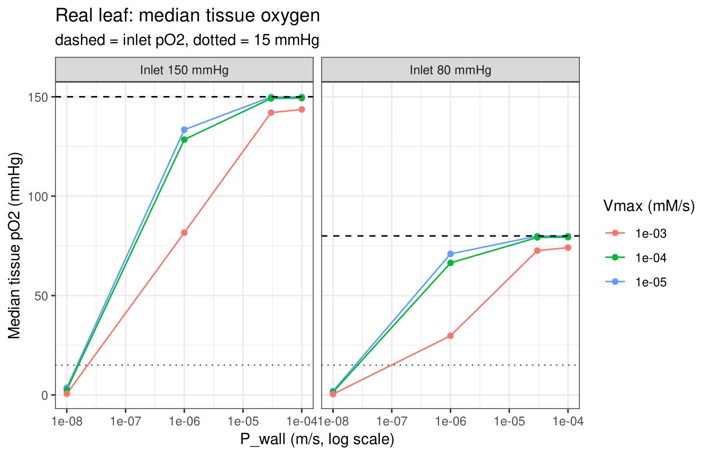
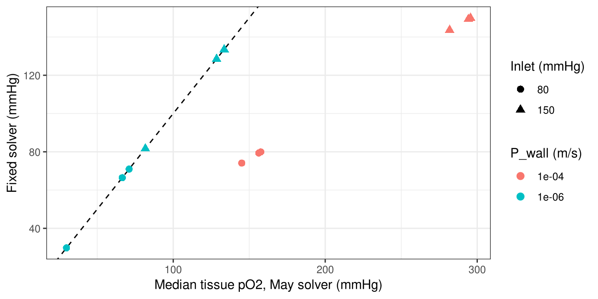

Oxygen sweep on the real leaf (ACJ01)
================
Chris Dargham

# 1. Aim

The oxygen screening solver was run on the real leaf for every
combination of:

- `P_wall`: how easily oxygen crosses the vessel wall (m/s), 4 levels.
- `Vmax`: how fast the tissue consumes oxygen (mM/s), 3 levels.
- `inlet_mmHg`: oxygen entering the network (mmHg), 2 levels.

The leaf geometry was rebuilt from the saved NetFlowV2 network, because
the original LeafVeinCNN file was lost
(`src/reconstruct/network_to_mat.py`). All other settings are the May
settings.

Questions:

1.  Is every run physically possible?
2.  Does the rebuilt leaf give the same answers as the May sweep report?
3.  Which parameter controls tissue oxygen most?
4.  What did the wall-exchange fix change on the real leaf?

# 2. Load and check

``` r
sweep <- read_csv(params$sweep)
cat("Runs:", nrow(sweep), "\n")
```

    ## Runs: 24

``` r
sweep %>% count(P_wall_m_s, name = "runs") %>%
  mutate(P_wall_m_s = sci(P_wall_m_s)) %>% knitr::kable()
```

| P_wall_m_s | runs |
|:-----------|-----:|
| 1e-08      |    6 |
| 1e-06      |    6 |
| 3e-05      |    6 |
| 1e-04      |    6 |

Tissue has no oxygen source other than the vessels, so tissue pO2 should
never be above the inlet value.

``` r
checks <- sweep %>% summarise(
  runs = n(),
  missing_values = sum(is.na(tissue_pO2_median_mmHg)),
  tissue_above_inlet = sum(tissue_pO2_max_mmHg > inlet_mmHg + 0.5),
  flagged_by_solver = sum(nonphysical_tissue_gt_inlet))
knitr::kable(checks)
```

| runs | missing_values | tissue_above_inlet | flagged_by_solver |
|-----:|---------------:|-------------------:|------------------:|
|   24 |              0 |                  0 |                 0 |

# 3. Comparison with the May sweep report

The May sweep table was lost, but the May report still shows the
percentage of tissue at or above 15 mmHg for its 12 runs, and two group
medians. The same 12 conditions are inside the new sweep.

``` r
may <- read_csv(params$may_report, comment = "#")

frac <- may %>% filter(quantity == "frac_tissue_ge_15mmHg_pct") %>%
  mutate(across(c(P_wall_m_s, Vmax_mM_s, inlet_mmHg), as.numeric)) %>%
  select(P_wall_m_s, Vmax_mM_s, inlet_mmHg, may_report = value) %>%
  inner_join(sweep %>% select(P_wall_m_s, Vmax_mM_s, inlet_mmHg,
                              rebuilt_leaf = frac_tissue_ge_15mmHg_pct),
             by = c("P_wall_m_s", "Vmax_mM_s", "inlet_mmHg")) %>%
  mutate(difference = rebuilt_leaf - may_report)

knitr::kable(frac %>% mutate(P_wall_m_s = sci(P_wall_m_s), Vmax_mM_s = sci(Vmax_mM_s)),
             digits = 1, caption = "Tissue >= 15 mmHg (%)")
```

| P_wall_m_s | Vmax_mM_s | inlet_mmHg | may_report | rebuilt_leaf | difference |
|:-----------|:----------|-----------:|-----------:|-------------:|-----------:|
| 1e-08      | 1e-05     |         80 |        0.0 |          0.0 |        0.0 |
| 1e-06      | 1e-05     |         80 |      100.0 |         99.1 |       -0.9 |
| 1e-08      | 1e-04     |         80 |        0.0 |          0.0 |        0.0 |
| 1e-06      | 1e-04     |         80 |      100.0 |         98.2 |       -1.8 |
| 1e-08      | 1e-03     |         80 |        0.0 |          0.0 |        0.0 |
| 1e-06      | 1e-03     |         80 |       99.4 |         89.0 |      -10.4 |
| 1e-08      | 1e-05     |        150 |        0.1 |          0.0 |       -0.1 |
| 1e-06      | 1e-05     |        150 |      100.0 |         99.8 |       -0.2 |
| 1e-08      | 1e-04     |        150 |        0.0 |          0.0 |        0.0 |
| 1e-06      | 1e-04     |        150 |      100.0 |         99.5 |       -0.5 |
| 1e-08      | 1e-03     |        150 |        0.0 |          0.0 |        0.0 |
| 1e-06      | 1e-03     |        150 |      100.0 |         95.1 |       -4.9 |

Tissue \>= 15 mmHg (%)

``` r
group_medians <- sweep %>%
  filter(P_wall_m_s %in% c(1e-8, 1e-6)) %>%
  group_by(P_wall_m_s) %>%
  summarise(rebuilt_leaf = median(tissue_pO2_median_mmHg)) %>%
  mutate(may_report = c(4.02, 104))
knitr::kable(group_medians %>% mutate(P_wall_m_s = sci(P_wall_m_s)), digits = 2,
             caption = "Median of the run medians of tissue pO2 (mmHg), 6 runs per P_wall")
```

| P_wall_m_s | rebuilt_leaf | may_report |
|:-----------|-------------:|-----------:|
| 1e-08      |         1.69 |       4.02 |
| 1e-06      |        76.30 |     104.00 |

Median of the run medians of tissue pO2 (mmHg), 6 runs per P_wall

The regime result is the same. At `P_wall` = 1e-8, no tissue reaches 15
mmHg in any condition (May report: at most 0.1%). At 1e-6, at least 89%
does (May report: at least 99.4%). The largest difference is 10.4
percentage points, at `Vmax` = 1e-03 and inlet 80 mmHg, the condition
with the highest consumption and the lowest supply.

The rebuilt leaf gives less oxygen than the May report: the group
medians are 1.7 vs 4.02 mmHg and 76.3 vs 104 mmHg. The likely reason is
geometry. The rebuilt veins are straight segments between nodes, with
the NetFlowV2 diameters (capped at 150 µm), not the original CNN
outline, so vein area and spacing differ. The rebuilt leaf therefore
reproduces the May conclusions, not the May numbers.

# 4. Effect of each parameter

``` r
ggplot(sweep, aes(P_wall_m_s, tissue_pO2_median_mmHg,
                  colour = sci(Vmax_mM_s), group = Vmax_mM_s)) +
  geom_line() + geom_point() +
  geom_hline(aes(yintercept = inlet_mmHg), linetype = "dashed") +
  geom_hline(yintercept = 15, linetype = "dotted", colour = "grey40") +
  scale_x_log10() +
  facet_wrap(~ paste("Inlet", inlet_mmHg, "mmHg")) +
  labs(x = "P_wall (m/s, log scale)", y = "Median tissue pO2 (mmHg)",
       colour = "Vmax (mM/s)",
       title = "Real leaf: median tissue oxygen",
       subtitle = "dashed = inlet pO2, dotted = 15 mmHg")
```

<!-- -->

To compare the parameters fairly, tissue pO2 is divided by the inlet
pO2. For each parameter, the mean of this ratio is taken at each of its
levels (averaging over the other two). The spread between its lowest and
highest level is its main effect.

``` r
sweep <- sweep %>% mutate(ratio = tissue_pO2_median_mmHg / inlet_mmHg)
main_effect <- function(df, var) {
  df %>% group_by(level = .data[[var]]) %>%
    summarise(mean_ratio = mean(ratio), .groups = "drop") %>%
    mutate(parameter = var)
}
effects <- bind_rows(main_effect(sweep, "P_wall_m_s"),
                     main_effect(sweep, "Vmax_mM_s"),
                     main_effect(sweep, "inlet_mmHg"))
knitr::kable(effects %>% transmute(parameter,
                                   level = ifelse(parameter == "inlet_mmHg", format(level), sci(level)),
                                   mean_ratio), digits = 3)
```

| parameter  | level   | mean_ratio |
|:-----------|:--------|-----------:|
| P_wall_m_s | 1e-08   |      0.015 |
| P_wall_m_s | 1e-06   |      0.730 |
| P_wall_m_s | 3e-05   |      0.973 |
| P_wall_m_s | 1e-04   |      0.978 |
| Vmax_mM_s  | 1e-05   |      0.728 |
| Vmax_mM_s  | 1e-04   |      0.712 |
| Vmax_mM_s  | 1e-03   |      0.583 |
| inlet_mmHg | 8.0e+01 |      0.663 |
| inlet_mmHg | 1.5e+02 |      0.686 |

``` r
spread <- effects %>% group_by(parameter) %>%
  summarise(spread = max(mean_ratio) - min(mean_ratio)) %>% arrange(desc(spread))
knitr::kable(spread, digits = 3)
```

| parameter  | spread |
|:-----------|-------:|
| P_wall_m_s |  0.963 |
| Vmax_mM_s  |  0.145 |
| inlet_mmHg |  0.023 |

P_wall_m_s has the largest effect (spread 0.96), then Vmax_mM_s (0.14),
then inlet_mmHg (0.02). The tested ranges are not evenly spaced, so this
ranks the parameters over the ranges tested, not per unit change.

# 5. The wall-exchange fix on the real leaf

The May solver updated wall exchange explicitly, in the same step as
diffusion. When `dt * k` was large, the update overshot and tissue
oxygen went above the inlet. The current solver treats exchange
semi-implicitly (`src/solver/oxy_sim_mat.py`, `compute_step`).

The runs at `P_wall` = 1e-6 and 1e-4 were repeated with the May solver.

``` r
before <- read_csv(params$before_fix) %>%
  select(run_id, P_wall_m_s, Vmax_mM_s, inlet_mmHg,
         median_before = tissue_pO2_median_mmHg, max_before = tissue_pO2_max_mmHg)
fix <- before %>%
  inner_join(sweep %>% select(run_id, median_after = tissue_pO2_median_mmHg,
                              max_after = tissue_pO2_max_mmHg), by = "run_id") %>%
  mutate(above_inlet_before = max_before > inlet_mmHg + 0.5,
         above_inlet_after = max_after > inlet_mmHg + 0.5)
fix_table <- fix %>% group_by(P_wall_m_s) %>%
  summarise(runs = n(),
            max_change_in_median_mmHg = max(abs(median_after - median_before)),
            highest_median_before = max(median_before),
            highest_max_before = max(max_before),
            runs_above_inlet_before = sum(above_inlet_before),
            runs_above_inlet_after = sum(above_inlet_after))
knitr::kable(fix_table %>% mutate(P_wall_m_s = sci(P_wall_m_s)), digits = 2)
```

| P_wall_m_s | runs | max_change_in_median_mmHg | highest_median_before | highest_max_before | runs_above_inlet_before | runs_above_inlet_after |
|:-----------|-----:|--------------------------:|----------------------:|-------------------:|------------------------:|-----------------------:|
| 1e-06      |    6 |                      0.06 |                133.52 |             147.27 |                       0 |                      0 |
| 1e-04      |    6 |                    145.68 |                295.61 |             823.97 |                       6 |                      0 |

``` r
ggplot(fix, aes(median_before, median_after, colour = sci(P_wall_m_s),
                shape = factor(inlet_mmHg))) +
  geom_abline(linetype = "dashed") + geom_point(size = 2.5) +
  labs(x = "Median tissue pO2, May solver (mmHg)", y = "Fixed solver (mmHg)",
       colour = "P_wall (m/s)", shape = "Inlet (mmHg)")
```

<!-- -->

At `P_wall` = 1e-6, the highest level in the May report, the fix changes
the median tissue pO2 by at most 0.061 mmHg, so the May report’s
conclusions stand. At 1e-4, the May solver puts tissue oxygen above the
inlet in 6 of 6 runs, with a maximum of 824 mmHg, which is physically
impossible. The fixed solver does so in 0 runs.

# 6. What this does and does not show

- The solver gives bounded, consistent answers on the real leaf
  geometry, and the rebuilt leaf reproduces the May sweep conclusions.
- Wall permeability decides whether the tissue is oxygenated. It has not
  been measured for decellularised leaves, so the answer is conditional
  on it.
- No result here is a measurement or a viability prediction. There is no
  experimental comparison.
- The solver builds its own flow field on the vein skeleton, with one
  inlet and one outlet. It does not use the NetFlowV2 flows from the
  outlet study.

``` r
sessionInfo()
```

    ## R version 4.3.3 (2024-02-29)
    ## Platform: x86_64-pc-linux-gnu (64-bit)
    ## Running under: Ubuntu 24.04.5 LTS
    ## 
    ## Matrix products: default
    ## BLAS:   /usr/lib/x86_64-linux-gnu/blas/libblas.so.3.12.0 
    ## LAPACK: /usr/lib/x86_64-linux-gnu/lapack/liblapack.so.3.12.0
    ## 
    ## locale:
    ## [1] C
    ## 
    ## time zone: Asia/Beirut
    ## tzcode source: system (glibc)
    ## 
    ## attached base packages:
    ## [1] stats     graphics  grDevices utils     datasets  methods   base     
    ## 
    ## other attached packages:
    ## [1] ggplot2_3.4.4 tidyr_1.3.1   dplyr_1.1.4   readr_2.1.5  
    ## 
    ## loaded via a namespace (and not attached):
    ##  [1] bit_4.0.5        gtable_0.3.4     highr_0.10       compiler_4.3.3  
    ##  [5] crayon_1.5.2     tidyselect_1.2.0 parallel_4.3.3   scales_1.3.0    
    ##  [9] yaml_2.3.8       fastmap_1.1.1    R6_2.5.1         labeling_0.4.3  
    ## [13] generics_0.1.3   knitr_1.45       tibble_3.2.1     munsell_0.5.0   
    ## [17] pillar_1.9.0     tzdb_0.4.0       rlang_1.1.3      utf8_1.2.4      
    ## [21] xfun_0.41        bit64_4.0.5      cli_3.6.2        withr_2.5.0     
    ## [25] magrittr_2.0.3   digest_0.6.34    grid_4.3.3       vroom_1.6.5     
    ## [29] hms_1.1.3        lifecycle_1.0.4  vctrs_0.6.5      evaluate_0.23   
    ## [33] glue_1.7.0       farver_2.1.1     fansi_1.0.5      colorspace_2.1-0
    ## [37] rmarkdown_2.25   purrr_1.0.2      tools_4.3.3      pkgconfig_2.0.3 
    ## [41] htmltools_0.5.7
